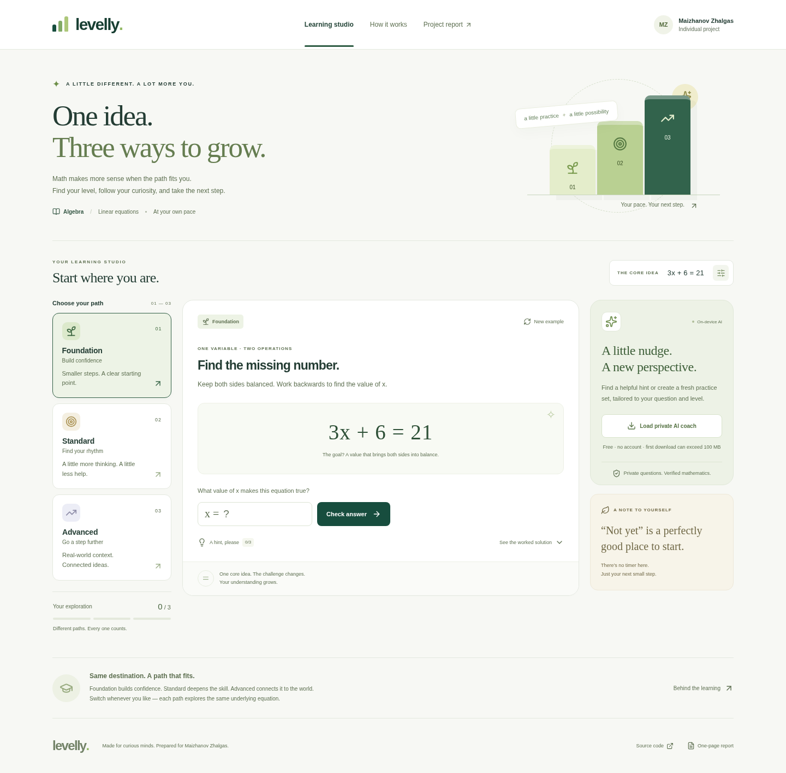

# Levelly — AI Math Differentiator

Prepared for **Maizhanov Zhalgas** · Topic 8: AI for Differentiated Learning

A responsive learning studio that adapts one linear equation into **Foundation,
Standard, and Advanced** paths. Built with React, Vite, and a private,
browser-based open-source AI coach. No paid API key or backend secret is needed.



## Run locally

Use Node.js 24 and npm 11. From the repository root:

```bash
npm ci --ignore-scripts
npm run dev
```

Open the local address printed by Vite. For a production build:

```bash
npm run build
npm run preview
```

`--ignore-scripts` avoids the optional Node-only ONNX Runtime postinstall;
this application uses the browser WebAssembly runtime. No model weights are
included in the repository. Model loading is initiated explicitly by the user.

## What the application does

- Foundation: solve `3x + 6 = 21`, with direct inverse-operation hints.
- Standard: solve `5x + 6 = 2x + 21`, by collecting variable terms.
- Advanced: compare bike-rental costs `5h + 6` and `2h + 21`; find both
  the break-even time (5 hours) and the shared cost ($31), then compare longer rentals.
- Switch levels without losing that example's work; progress is stored only
  in the current browser tab's session storage.
- Reveal three level-specific hints or a full verified worked solution.
- Generate another example or edit the shared equation. Changing the equation
  resets progress across its three connected paths.
- Check answers immediately, including partial feedback when Advanced's time
  is correct but its price is wrong.

The lesson supports `ax + b = c`, with integer `a` from 1–12, `b` from 0–40,
`c` from 1–400, and a positive integer solution from 1–30. This is an explicit
whole-number lesson, not a general symbolic equation solver.

## Genuine AI integration and correctness

Click **Load private AI coach** to download the quantized
[`onnx-community/SmolLM2-135M-Instruct`](https://huggingface.co/onnx-community/SmolLM2-135M-Instruct)
model. Transformers.js performs inference in a Web Worker using WebAssembly.
The initial model download can exceed 100 MB; download time and inference speed
depend on the device. Modern browsers and sufficient memory are required.

The learner asks a question. A level-specific system prompt asks the model to
select **A** (getting started), **B** (making algebraic progress), or **C**
(checking the result). The app validates the model output and displays the
corresponding verified hint. **Create an AI practice set** instead asks the model
to choose simpler, regular, or extended parameters for the learner, then transforms
that verified core into all three task levels. This is **LLM-based hint and
practice-set selection**, not unrestricted LLM arithmetic generation. The level
transformations, solutions, and answer checking use the tested algebra engine.

This separation prevents hallucinated calculations from reaching the displayed
answers. The small model may still select a less helpful hint. Direct access
to all hints is always available. Invalid model output and download/inference
failures produce a visible error, never a fabricated “AI” response.

Questions and answers are not sent to an inference server. Model downloads
contact Hugging Face, which receives normal request metadata. The model files
may be cached by the browser. Questions are not stored in session storage.
The upstream model currently follows revision `main`; record/pin a tested
model commit before relying on identical inference across future versions.

See [actual prompts and design rationale](docs/PROMPTS.md) and
[the one-page report](public/report.pdf).

## Tests

```bash
npm test
npx playwright install chromium   # once, if Chromium is not installed
npm run test:e2e
```

The browser suite uses an existing `/usr/bin/chromium` if present. On Linux CI,
use `npx playwright install --with-deps chromium`. It tests the **production
build**, on desktop and mobile, rather than relying on Vite's development server.

- 13 math/prompt tests, including 2,000 generated examples checked at all levels.
- 14 browser tests covering input validation, all paths, partial feedback,
  persistence, new examples, dialogs, mobile overflow, AI-download failures,
  automated WCAG A/AA checks at every level, and an explicitly mocked AI-transport
  fixture for hint/practice-set UI wiring.
- Production dependency audit and production build.

Automated accessibility checks are useful evidence, not a complete manual
accessibility certification. Failure-path tests intentionally block model
downloads, and the AI-transport fixture supplies synthetic choices;
**neither proves successful real-model inference**.

For a separate, real-model integration attempt (no mocked model response):

```bash
npm run build
npm run preview -- --port 4173
# In another terminal:
node scripts/check-live-ai.mjs
```

See [verification status](docs/VERIFICATION.md) for executed checks and external
access limitations.

## Deployment and submission

The submission consists of:

1. A working public deployment URL.
2. A public source repository: <https://github.com/johndoe018/assignment7>.
3. [One-page PDF report](public/report.pdf), with editable [Markdown](docs/REPORT.md).

GitHub Pages deployment is configured in `.github/workflows/deploy.yml`.
The source repository is public. After enabling Pages, the deployment workflow
completed successfully and GitHub reported the published site address below.
Enable **Settings → Pages → Build and deployment → Source: GitHub Actions**,
and push to `main` (or run the workflow manually) when setting up a new copy.
The published address reported by GitHub is
<https://johndoe018.github.io/assignment7/>.
Direct public-site requests from this cloud environment remain blocked by its
network proxy, so a successful remote deployment is distinguished from a
direct functional check of the public URL.
See [deployment steps and alternatives](docs/DEPLOYMENT.md). Netlify and Vercel
configuration files are also included. This static application does not require
a server-side API key. HTTPS hosting is recommended for the AI runtime and cache.

## Assignment coverage

| Requirement | Implementation |
| --- | --- |
| Responsive, interactive website | React UI, mobile layout, semantic forms, keyboard dialogs |
| Three differentiation levels | `src/math.mjs`, same underlying solution and progressively reduced scaffolding |
| Real AI integration | `src/ai.worker.js`, local SmolLM2 inference with validated hint selection |
| Adapted prompts and feedback | `src/prompts.mjs`, level-specific hints, full solutions, immediate checking |
| Source and setup documentation | This repository, lockfile, tests, README |
| Brief report | `public/report.pdf` — exactly one A4 page |
| Live deployment | Deployment workflow included; remote activation and live verification are separate |

## Development assistance and original work

This implementation and report were created with AI assistance for Maizhanov
Zhalgas. No external student solution or application template was copied.
The learner should review and understand the code, prompts, mathematical
reasoning, and the course's authorship rules before submitting. This disclosure
does not claim the learner independently wrote the generated implementation.

React, Vite, Lucide, Transformers.js, and the model are third-party dependencies
with their respective upstream licenses. Application source is MIT licensed.

To regenerate the report on Linux with DejaVu fonts installed:

```bash
python3 -m pip install -r scripts/requirements-report.txt
python3 scripts/generate_report.py
```

The application itself does not need Python or ReportLab at runtime.
